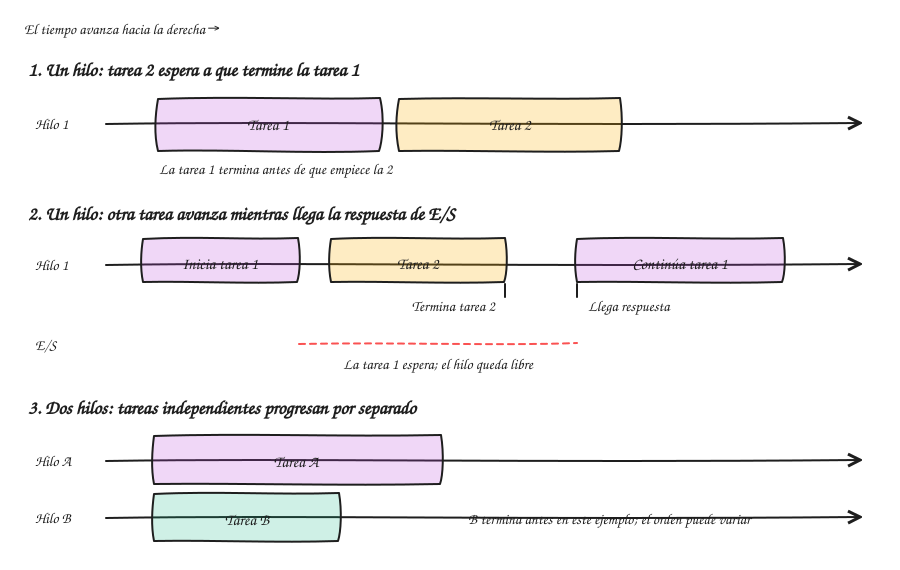
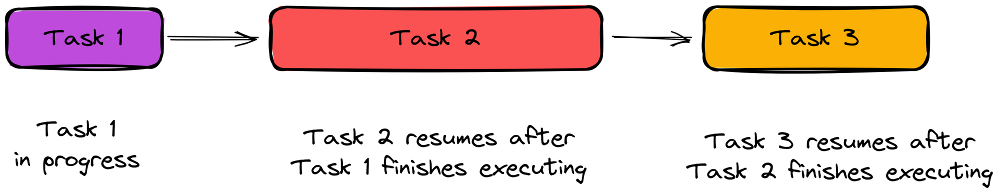
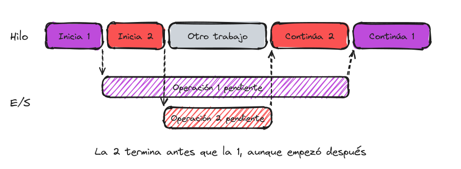
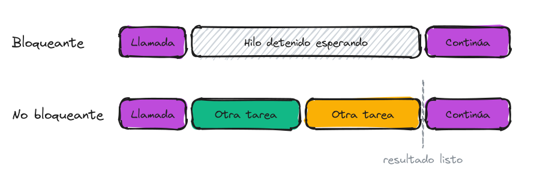
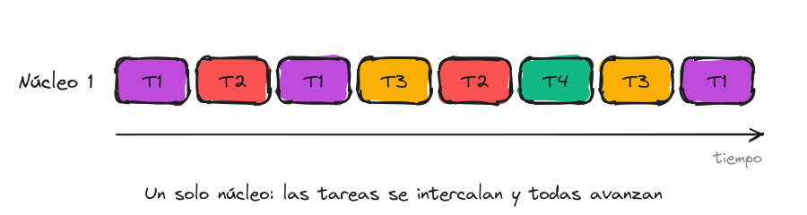
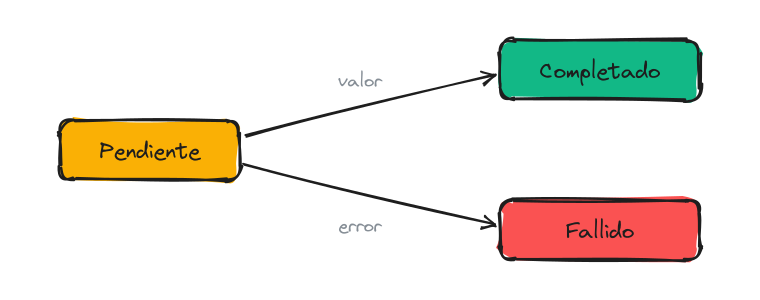
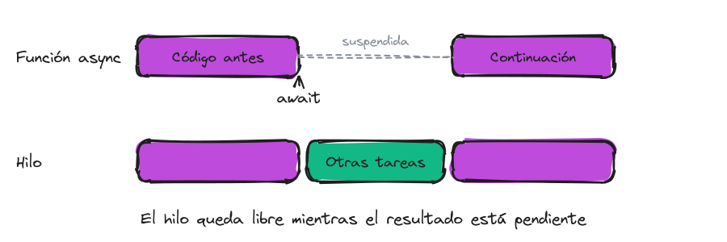
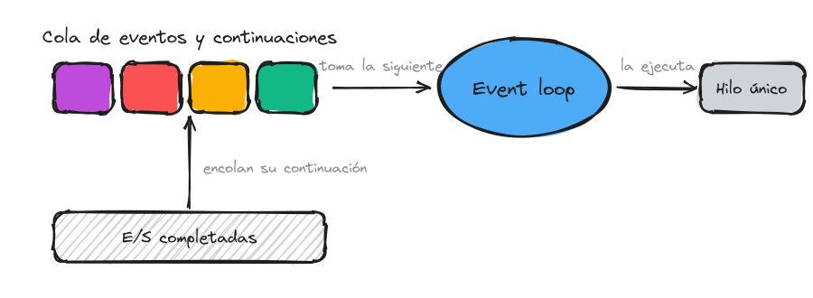
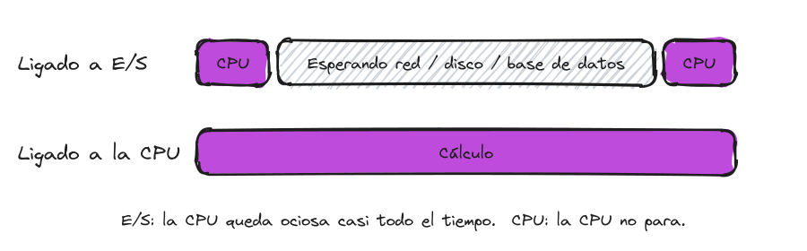

# Asincronismo

## Definiciones

### Hilo de ejecución (thread)

Un **hilo** es una ruta de ejecución dentro de un proceso: avanza por una secuencia de instrucciones y conserva el estado necesario para continuar, como su posición actual y una pila propia de llamadas y variables locales. El sistema operativo planifica los hilos y les asigna tiempo de ejecución en los procesadores disponibles.

Un proceso puede tener uno o varios hilos. Los hilos de un mismo proceso comparten la memoria y otros recursos, pero cada hilo avanza por su propio flujo de instrucciones. Esa memoria compartida permite intercambiar datos, aunque también requiere coordinación para evitar accesos conflictivos.

Con un solo núcleo, el procesador ejecuta un hilo a la vez y puede alternar entre varios, haciendo que sus tareas progresen de forma intercalada. Con varios núcleos, distintos hilos pueden ejecutarse literalmente al mismo tiempo. Mantener hilos tiene un costo, como la memoria de sus pilas y el tiempo para alternar entre ellos, por lo que son un recurso limitado; los entornos de ejecución suelen administrarlos mediante un **pool de hilos**.

El dibujo muestra **tareas**: el trabajo que se quiere realizar. En un flujo sincrónico y bloqueante, la tarea 2 espera a que termine la tarea 1. En cambio, al iniciar una tarea que espera una respuesta de E/S de forma no bloqueante, el hilo queda disponible para ejecutar otra tarea lista mientras llega esa respuesta. No es que la tarea 1 le transfiera el hilo a una tarea concreta: el hilo deja de esperar y el entorno de ejecución decide qué trabajo ejecutar. Si el código espera el resultado antes de continuar (por ejemplo, con `await`), esa parte de la tarea 1 queda suspendida; mientras tanto, el hilo puede atender otras tareas. Cuando el resultado llega, la tarea 1 continúa, quizá en el mismo hilo o en otro, según el entorno.

Si hay varios hilos, sus tareas pueden avanzar independientemente y terminar en distinto orden al que empezaron; ese orden depende de cuánto tardan y de cómo se planifican. En un solo núcleo se intercalan, y con varios núcleos pueden ejecutarse en paralelo.

### Ejecución sincrónica

Modelo de ejecución en el que quien invoca una operación espera a que esta finalice y devuelva su resultado antes de continuar con la siguiente instrucción. El inicio y la finalización de la operación quedan acoplados al flujo de control del invocador: las instrucciones se completan en el mismo orden en que se escribieron.

### Ejecución asincrónica

Modelo de ejecución en el que la invocación inicia la operación y devuelve el control al invocador de inmediato, sin el resultado. La finalización se informa más tarde, mediante un callback, un evento o un objeto que representa el resultado futuro. El asincronismo desacopla el inicio de una operación de su finalización: el orden en que las operaciones terminan ya no está determinado por el orden en que se iniciaron.

### Operación bloqueante y no bloqueante

Una operación **bloqueante** suspende el hilo que la invoca hasta que se completa; durante ese tiempo el hilo no puede usarse para ninguna otra tarea. Una operación **no bloqueante** retorna de inmediato, haya terminado o no, y deja al hilo libre.

Sincrónico/asincrónico describe el modelo de interacción entre quien invoca y la operación; bloqueante/no bloqueante describe qué ocurre con el hilo mientras tanto. En una operación asincrónica, la continuación puede reanudarse más tarde, incluso en otro hilo. El beneficio del asincronismo aparece cuando se combina con operaciones no bloqueantes.

### Concurrencia

Propiedad de un sistema en el que varias tareas tienen ciclos de vida superpuestos en el tiempo: una tarea puede comenzar antes de que otra termine y ambas progresan de manera intercalada. La concurrencia es una cuestión de **estructura**: cómo se descompone un problema en tareas que pueden avanzar de forma independiente, sin que el orden de ejecución altere el resultado. Puede darse con un único núcleo de procesamiento.

### Paralelismo

Ejecución simultánea de varias computaciones en distintas unidades de procesamiento (núcleos o procesadores). El paralelismo es una cuestión de **ejecución** y requiere soporte de hardware.

Un sistema puede ser concurrente sin ser paralelo (un solo núcleo intercalando tareas) y el asincronismo no implica paralelismo: una operación asincrónica de E/S puede completarse sin que ningún hilo esté ocupado esperándola.

### Future / Promise / Task

Objeto que actúa como representante de un resultado que todavía no está disponible. Se encuentra en uno de tres estados: **pendiente**, **completado** con un valor o **fallido** con un error. Según el lenguaje recibe el nombre de *Future* (Java, Rust, Python), *Promise* (JavaScript) o *Task* (C#).

### Callback y continuación

Un **callback** es una función que se entrega a una operación asincrónica para que esta la invoque cuando finalice. Una **continuación** es, de forma más general, el resto del cómputo que debe ejecutarse una vez disponible el resultado.

### async / await

Construcciones presentes en muchos lenguajes que permiten escribir código asincrónico con la forma de código secuencial. `await` marca un **punto de suspensión**: si el resultado esperado no está disponible, la función se suspende y libera el hilo; cuando el resultado llega, la ejecución se reanuda desde ese punto como una continuación. `async` marca una función que contiene puntos de suspensión y que, por lo tanto, devuelve un Future/Promise/Task.

### Event loop

Mecanismo que procesa, en un único hilo, una cola de eventos y continuaciones pendientes. Es la base del modelo asincrónico de entornos como JavaScript (navegadores y Node.js).

### Trabajo ligado a E/S y ligado a la CPU

- **Ligado a E/S (I/O-bound)**: su duración está dominada por la espera de un recurso externo (red, disco, base de datos). La CPU permanece ociosa. El asincronismo con operaciones no bloqueantes evita ocupar un hilo durante la espera.
- **Ligado a la CPU (CPU-bound)**: su duración está dominada por el cómputo. Sólo se acelera con paralelismo o con un algoritmo mejor. El asincronismo sólo sirve para no bloquear al hilo invocante, delegando el cómputo a otro hilo.

Antes de escribir código conviene clasificar el trabajo:

- ¿El código espera algo externo, como una consulta a una base de datos, una respuesta de red o la lectura de un archivo? Entonces está ligado a E/S.
- ¿El código realiza un cálculo costoso? Entonces está ligado a la CPU.

### Beneficios

- **Capacidad de respuesta**: en una interfaz de usuario, el hilo que procesa los eventos de la pantalla no queda bloqueado mientras se espera una operación lenta.
- **Escalabilidad**: en un servidor, cada solicitud se atiende con hilos de un pool limitado. Si esos hilos quedan bloqueados esperando E/S, el pool se agota y las solicitudes se encolan. Con E/S asincrónica, el mismo número de hilos atiende más solicitudes concurrentes.

El asincronismo no reduce la latencia de una operación individual; mejora el uso de los recursos mientras esa operación está pendiente.

### Problemas frecuentes

- **Bloqueo sobre un resultado asincrónico** (*sync over async*): esperar de forma bloqueante a que un Future/Promise/Task complete. Ocupa el hilo igual que una llamada sincrónica y, en contextos con un único hilo de sincronización, puede producir un **deadlock**.
- **Asincronismo sobre trabajo de CPU sin delegación**: marcar como asincrónico un cómputo que se ejecuta en el mismo hilo no libera nada.
- **Condición de carrera** (*race condition*): el resultado depende del orden en que terminan tareas concurrentes que acceden a un mismo estado compartido. Requiere coordinación explícita (sincronización o diseño sin estado compartido).
- **Errores no observados**: una operación asincrónica que falla y cuyo Future/Promise/Task nunca se espera pierde la excepción silenciosamente.

## Un ejemplo fuera de la programación: el restaurante

Un restaurante tiene un único mozo y una cocina.

### El mozo que espera

1. Toma el pedido de la mesa 1.
2. Lleva la comanda a la cocina.
3. Se queda parado en la puerta de la cocina durante los 20 minutos que tarda el plato.
4. Sirve el plato a la mesa 1.
5. Recién entonces va a la mesa 2, que lleva 25 minutos esperando para pedir.

Durante esos 20 minutos el mozo no trabajó: la cocina cocinaba y él sólo esperaba. Mientras tanto, el resto del salón quedó sin atención.

### El mozo que no espera

1. Toma el pedido de la mesa 1.
2. Deja la comanda en la cocina, que se compromete a avisar con una campana cuando el plato esté listo.
3. Va a la mesa 2, toma el pedido y lo deja en la cocina.
4. Lleva la cuenta a la mesa 3.
5. Suena la campana: el plato de la mesa 1 está listo. Lo busca y lo sirve.

Con la misma persona, el salón entero está atendido. El plato no salió más rápido: la cocina tardó lo mismo. Si el pedido de la mesa 2 era una ensalada, puede haber salido antes que el de la mesa 1.

### Más mozos y servilletas

Si el dueño contrata cuatro mozos, cuatro mesas se atienden literalmente al mismo tiempo.

Un día, al mozo le piden doblar 300 servilletas. Nadie más puede hacerlo por él y la tarea lo ocupa por completo; dejar comandas en la cocina no lo ayuda. La única forma de no descuidar el salón es que las doble otra persona.

### Correspondencia con los conceptos

- **El mozo** → Hilo de ejecución
- **La cocina** → Recurso externo: base de datos, red, disco
- **El mozo parado en la puerta de la cocina** → Operación bloqueante, ejecución sincrónica
- **Dejar la comanda y seguir atendiendo** → Operación no bloqueante, ejecución asincrónica
- **La comanda con la promesa de avisar** → Future / Promise / Task
- **La campana** → Callback / notificación de finalización
- **Ir a buscar el plato cuando suena la campana** → Continuación después de un `await`
- **Un mozo atendiendo varias mesas intercaladamente** → Concurrencia
- **Cuatro mozos atendiendo cuatro mesas a la vez** → Paralelismo
- **Esperar a la cocina** → Trabajo ligado a E/S
- **Doblar servilletas** → Trabajo ligado a la CPU
- **Que otra persona doble las servilletas** → Delegar el cómputo a otro hilo
- **El plato que se quema** → Future / Promise / Task fallido
- **Mesas sin atender mientras el mozo espera** → Aplicación "congelada" o pool de hilos agotado

## Implementaciones por lenguaje

- C#: [Programación asincrónica con async y await](https://learn.microsoft.com/es-es/dotnet/csharp/asynchronous-programming/)
- JavaScript: [Introducción a JavaScript asíncrono](https://developer.mozilla.org/es/docs/Learn/JavaScript/Asynchronous/Introducing)
